# TowerDefenseGame

**타워를 뽑고 배치해 웨이브를 막는 3D 로그라이크 타워 디펜스 프로토타입**

> 엄태호 · 1인 개발 · 게임플레이 프로그래머 · 2026.05.18–2026.06.14

<p align="center">
  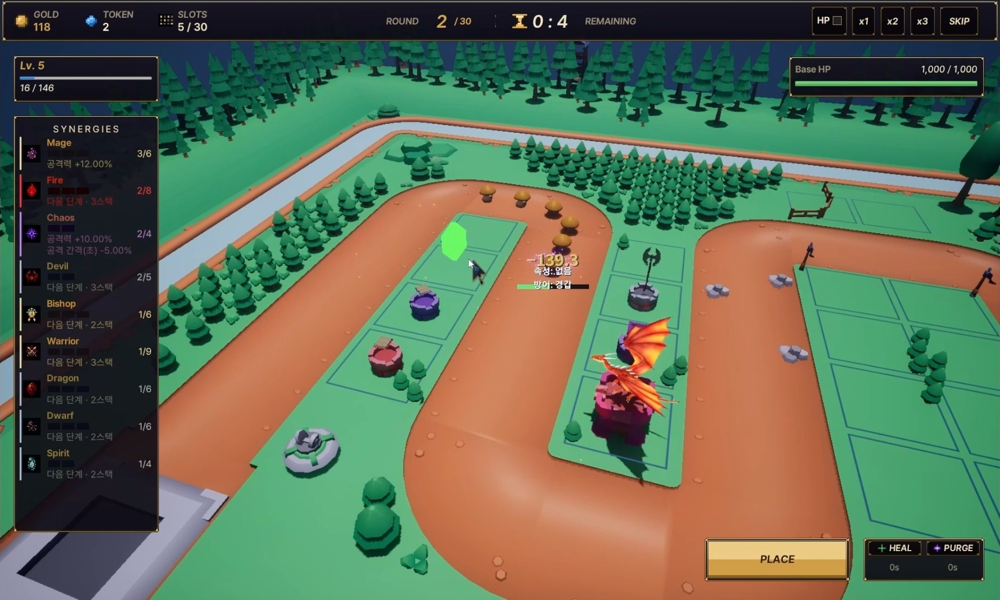
  <br />
  <sub>최종 포트폴리오 PPTX에 포함된 플레이 화면 캡처</sub>
</p>

| 항목 | 내용 |
| --- | --- |
| 개발 형태 | 개인 프로젝트, 1명 |
| 담당 | 게임 규칙·GDD 기록, C++ 게임플레이 시스템, UI 연동 |
| 개발 기간 | 2026.05.18–2026.06.14 |
| 엔진 / 언어 | Unreal Engine 5.3으로 개발 시작, UE 5.8에서 C++ Editor 타깃 빌드 확인 / C++ |
| 플랫폼 | PC |
| 개발 기록 | 기능별 Git 커밋 이력은 없음. 날짜별 GDD와 작업 파일을 바탕으로 구현 범위를 정리 |

## 포트폴리오 자료

- **최종 플레이 영상:** (https://naver.me/FlBoBDJV)
- **소스 코드:** [TowerDefenseGame GitHub 저장소](https://github.com/KimHelpMe/TowerDefenseGame)
- **개인 포트폴리:** (https://naver.me/GDQABiKZ)
## 프로젝트와 플레이 흐름

전장 타일에 슬롯을 만들고, 가챠에서 타워를 선택해 설치합니다. 타워의 공격 방식과 속성, 적의 방어 타입, 필드 타워의 시너지 구성을 이용해 웨이브를 방어하는 구조입니다.

최종 영상은 다음 순서로 기능을 보여줍니다.

1. 메인 HUD: 골드, 타워 토큰, 슬롯 수, 라운드와 남은 시간, 플레이어 경험치, 기지 HP, 시너지 정보
2. 그리드 타일 선택과 타워 슬롯 설치
3. 가챠 카드 선택, 리로드, 포기 처리
4. 단일·다중·범위 공격과 마나 기반 공격
5. 타워 상세 정보와 시너지 단계 표시
6. 속성·방어 타입 상성과 피격 정보
7. 적 스폰, 보스 페이즈 전환과 부하 소환
8. Purge / Heal 액션 시연

## 기능별 이미지

아래 장면은 최종 포트폴리오 PPTX에 들어간 게임 화면 캡처입니다. 마나 타워 이미지는 화면 캡처 대신 실제 코드 흐름을 도식화했습니다.

<table>
  <tr>
    <td width="50%" valign="top">
      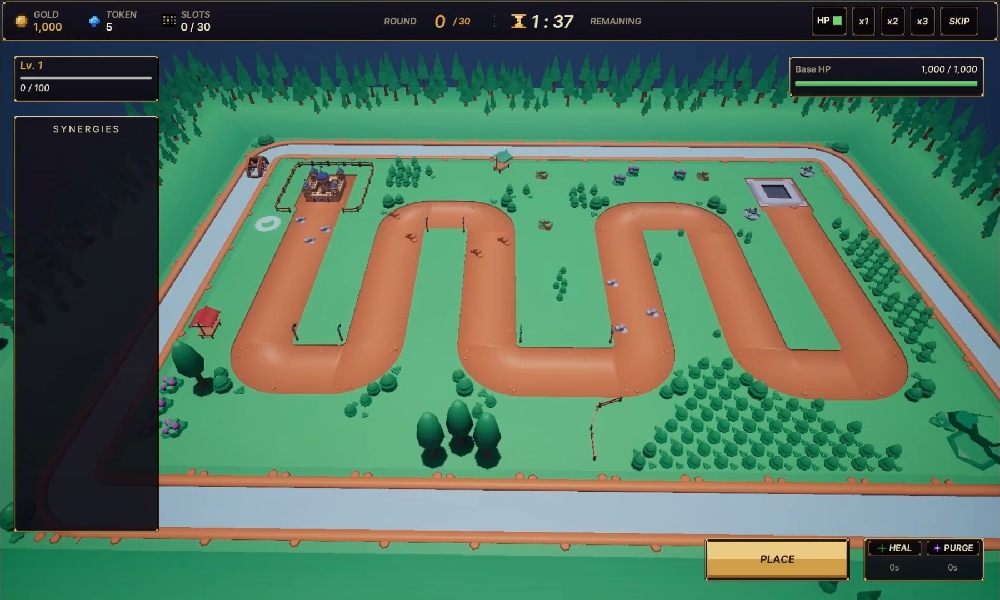
      <br /><strong>01 · 메인 HUD</strong><br />골드·타워 토큰·슬롯·라운드·남은 시간·경험치·기지 HP와 시너지 패널을 확인할 수 있습니다.
    </td>
    <td width="50%" valign="top">
      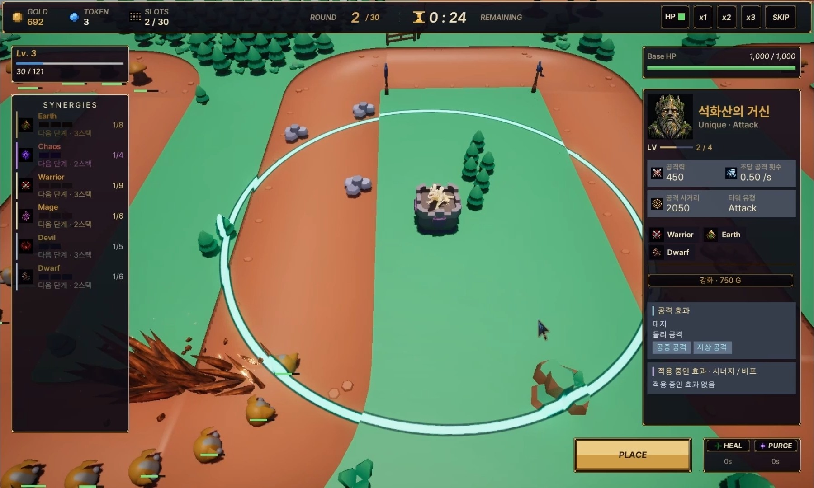
      <br /><strong>02 · 그리드 배치와 사거리</strong><br />타워 슬롯과 타일 배치 상태, 선택한 타워의 공격 범위를 함께 보여줍니다.
    </td>
  </tr>
  <tr>
    <td width="50%" valign="top">
      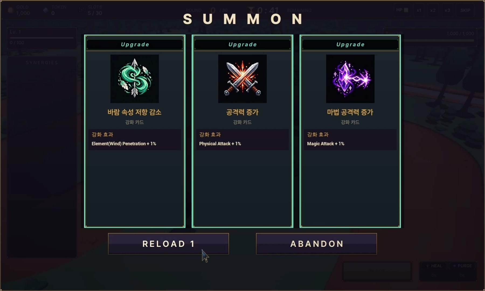
      <br /><strong>03 · 가챠 선택·리로드·포기</strong><br />세 가지 카드 선택지와 리로드 횟수, 포기 버튼이 표시됩니다.
    </td>
    <td width="50%" valign="top">
      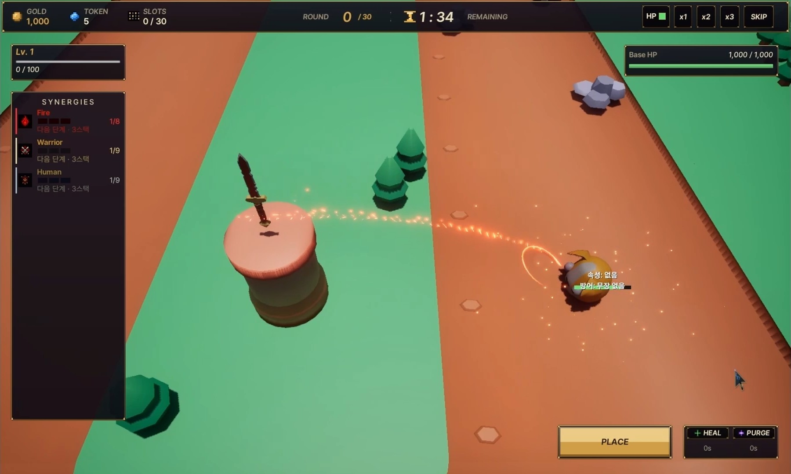
      <br /><strong>04 · 타깃 공격</strong><br />사거리 안의 적을 향한 공격과 적의 속성·방어 라벨을 확인할 수 있습니다.
    </td>
  </tr>
  <tr>
    <td width="50%" valign="top">
      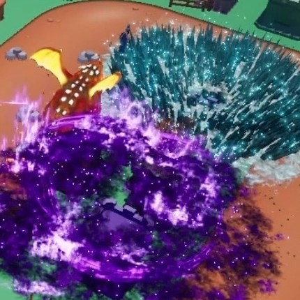
      <br /><strong>05 · 범위 공격 연출</strong><br />보스 전투 중 여러 공격 이펙트가 보이는 순간을 잘라 배치했습니다.
    </td>
    <td width="50%" valign="top">
      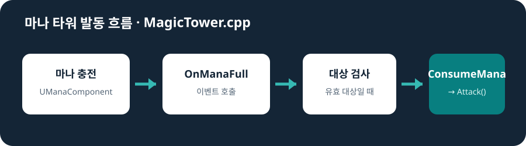
      <br /><strong>06 · 마나 타워 발동 흐름</strong><br />`OnManaFull` 이벤트에서 유효 대상을 확인한 뒤 마나를 소모하고 공격합니다.
    </td>
  </tr>
  <tr>
    <td width="50%" valign="top">
      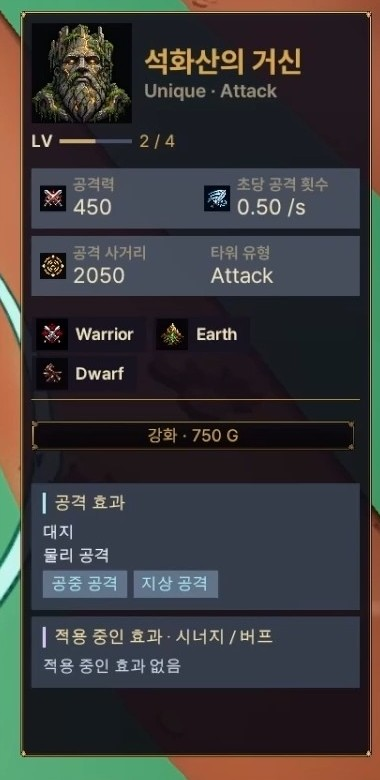
      <br /><strong>07 · 타워 상세 정보</strong><br />선택 타워의 능력치와 공격 유형, 태그, 강화 및 적용 효과를 표시합니다.
    </td>
    <td width="50%" valign="top">
      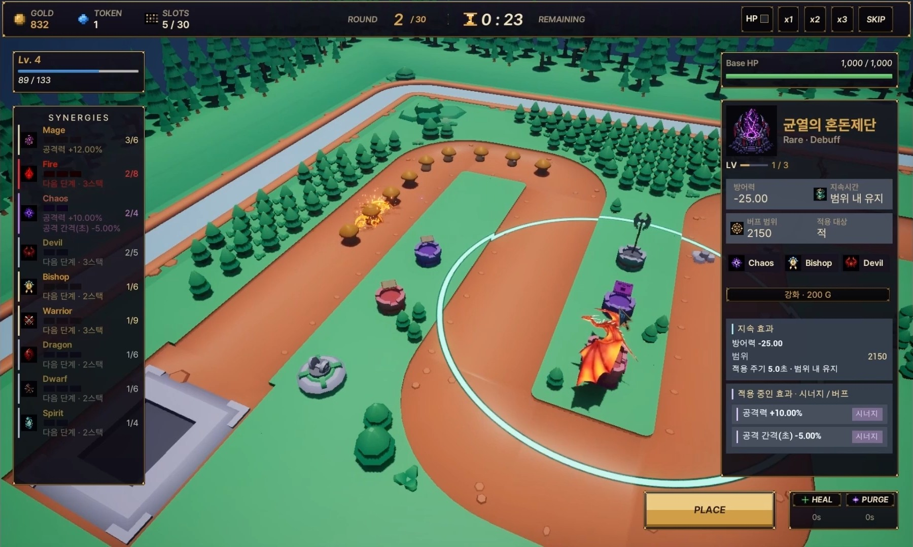
      <br /><strong>08 · 시너지 적용</strong><br />필드 타워 태그 집계와 단계별 효과가 시너지 패널·타워 정보에 표시됩니다.
    </td>
  </tr>
  <tr>
    <td width="50%" valign="top">
      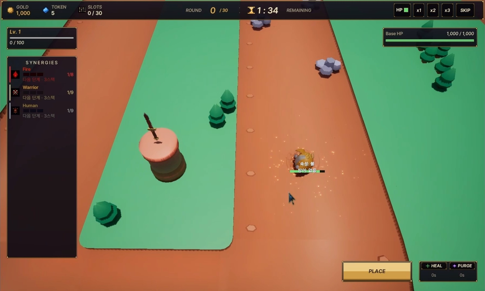
      <br /><strong>09 · 피해와 상성 표시</strong><br />피해 숫자와 적의 속성·방어 정보를 함께 확인할 수 있는 장면입니다.
    </td>
    <td width="50%" valign="top">
      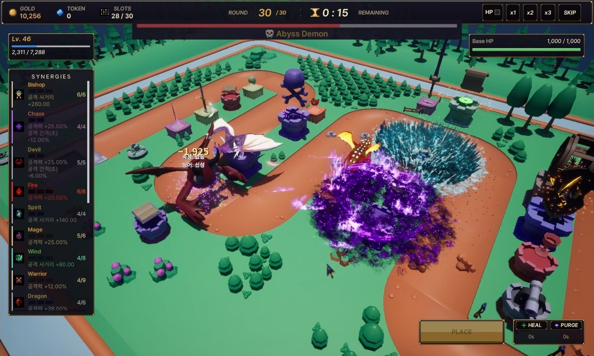
      <br /><strong>10 · 보스 전투</strong><br />보스 HP와 전장 내 타워·적 전투가 보이는 최종 라운드 화면입니다.
    </td>
  </tr>
  <tr>
    <td width="50%" valign="top">
      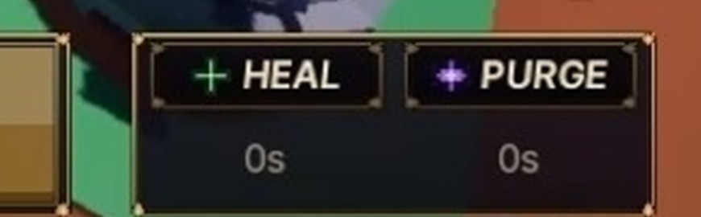
      <br /><strong>11 · Heal / Purge 액션</strong><br />화면 오른쪽 아래의 회복·전멸 액션 버튼과 표시된 타이머를 보여줍니다.
    </td>
    <td width="50%" valign="top">
      
      <br /><strong>전투 화면 종합</strong><br />타워 배치와 적 전투, HUD 정보를 한 장면에서 확인할 수 있습니다.
    </td>
  </tr>
</table>

## 구현에서 확인할 수 있는 설계

### 타워 타깃과 공격 방식 분리

타워는 사거리 오버랩으로 유효 대상을 관리하고, 공격 발동 뒤 공통 `AttackTypeComponent`에 현재 타깃 목록을 전달합니다. 단일·다중·범위 공격은 각각의 컴포넌트가 처리하므로 타워의 발동 조건과 공격 형식을 분리할 수 있습니다.

- `ATargetingTower::Attack_Implementation()` — 대상 목록을 정리하고 공격 컴포넌트에 위임
- `USingleAttackComponent::ExecuteAttack()` — 첫 번째 유효 대상을 향해 발사체 생성
- 코드: [`TargetingTower.cpp`](Source/TowerDefense/01_Tower/TargetingTower.cpp), [`SingleAttackComponent.cpp`](Source/TowerDefense/06_Components/Attack/SingleAttackComponent.cpp)

### 마나가 찼을 때 공격 발동

`UManaComponent`의 마나 충족 이벤트를 `AMagicTower`가 구독합니다. 공격 대상과 필수 컴포넌트가 유효할 때만 마나를 소모하고 공격을 시작해, 마나 타워의 발동 조건을 일반 타이머 기반 타워와 구분합니다.

- `AMagicTower::BeginPlay()`, `AMagicTower::OnManaFull()`
- 코드: [`MagicTower.cpp`](Source/TowerDefense/01_Tower/MagicTower.cpp), [`ManaComponent.cpp`](Source/TowerDefense/06_Components/Mana/ManaComponent.cpp)

### 가챠 포기와 슬롯 상태 복구

가챠를 포기할 수 있는 상태인지 확인한 뒤 창을 닫고, 점유 중이던 타일과 슬롯 카운트를 함께 복구합니다. 액터만 제거해 설치 상태가 남는 문제를 막는 처리입니다.

- `AGachaManager::Reload()`, `AGachaManager::AbandonGacha()`
- 코드: [`GachaManager.cpp`](Source/TowerDefense/05_Gacha/GachaManager.cpp)

### DataTable과 Gameplay Tag를 이용한 피해·시너지 계산

적의 피해 처리에서는 공격 속성과 적의 방어 타입 배율을 조회하고, 방어력·속성 저항을 반영한 뒤 실드와 HP에 적용합니다. 시너지는 필드 타워의 Gameplay Tag를 집계해 DataTable의 단계 조건과 비교하고, 단계 효과를 각 타워의 버프에 반영합니다.

- `AEnemy::ReceiveDamage()` — 속성·방어 타입·방어력·저항·실드 순서로 피해 처리
- `ASynergyManager::UpdateSynergies()` — 태그 수와 DataTable 단계에 따라 버프 갱신 및 UI 알림
- 코드: [`Enemy.cpp`](Source/TowerDefense/02_Enemy/Enemy.cpp), [`SynergyManager.cpp`](Source/TowerDefense/03_Core/SynergyManager.cpp)

### 보스 페이즈와 경로를 잇는 부하 소환

보스의 페이즈가 바뀌면 능력 컴포넌트가 부하를 생성합니다. 소환된 적에게 보스의 스플라인 경로와 현재 경로 지점을 넘겨, 등장 위치부터 이동을 이어가도록 구성했습니다.

- `UBossAbilityComponent::OnPhaseChanged()`, `UBossAbilityComponent::SpawnMinions()`
- 코드: [`BossAbilityComponent.cpp`](Source/TowerDefense/06_Components/Enemy/BossAbilityComponent.cpp)

## 공개 저장소 범위와 실행 안내

이 저장소는 **포트폴리오용 C++ 소스 공개본**입니다. 전체 실행 프로젝트의 백업은 아닙니다.

- 공개: `Source/`, `Config/`, `TowerDefense.uproject`, 문서
- 제외: `Content/` 전체, 외부 에셋 원본, 로컬 아트 파일, 생성 파일
- `Content/`에는 직접 만든 Blueprint·UI·DataTable과 외부 에셋이 함께 있어, 출처와 재배포 조건을 확인하기 전까지 공개하지 않습니다. 전체 원본은 로컬에 보존합니다.
- 따라서 저장소를 복제한 상태만으로는 게임을 바로 실행할 수 없습니다. [Content 복원 안내](Docs/Content-Restoration.md)를 확인하고, 실행 권한이 있는 전체 프로젝트의 `Content/`를 준비해야 합니다.
- UE 5.8의 `Development Editor` / `Win64` C++ 타깃 빌드를 확인했습니다. `Content/` 복원 뒤 에디터에서 플레이하는 단계는 확인되지 않았습니다.

개발 당시 Git에 기능별 커밋을 남기지 않아, 공개 저장소는 로컬 최종 프로젝트의 원래 커밋 이력을 재현하지 않습니다. 최종 영상·PPTX와 공개 `main`의 소스 상태가 완전히 같다고 보장하지 않으며, 최종 자료에 포함된 일부 후반 수정은 공개 소스에 아직 반영되지 않았을 수 있습니다.

### 로컬에서 준비하기

```bash
git clone https://github.com/KimHelpMe/TowerDefenseGame.git
cd TowerDefenseGame
```

1. Unreal Engine 5.8과 Visual Studio C++ 개발 도구를 준비합니다.
2. 실행 권한이 있는 프로젝트 원본에서 `Content/`를 복원합니다.
3. `TowerDefense.uproject`에서 Visual Studio 프로젝트 파일을 생성합니다.
4. `Development Editor` / `Win64`로 빌드한 뒤 Unreal Editor에서 프로젝트를 엽니다.

기본 맵 설정은 `/Game/00_Level/EmptyLevel`입니다. 공개 소스만으로 맵·Blueprint·에셋을 복원할 수는 없습니다.

## 폴더 구조

```text
Config/                   프로젝트 설정과 GameplayTag 설정
Docs/                     공개 범위와 Content 복원 안내
Source/TowerDefense/
  01_Tower/               타워, 발사체, 공격 발동
  02_Enemy/               적과 보스
  03_Core/                게임 진행, 그리드, 시너지 관리자
  04_UI/                  UI 연동 클래스
  05_Gacha/               가챠, 슬롯, 선택 처리
  06_Components/          공격, 마나, 스탯, 버프, 적 능력
  07_Data/                DataTable 행 구조체
TowerDefense.uproject
```

## 라이선스

저장소에는 별도의 오픈소스 라이선스를 추가하지 않았으며, 이 공개가 외부 에셋의 재배포나 재사용 권한을 부여하지 않습니다. 각 에셋의 권리는 원래 배포처의 조건을 따릅니다.

## 연락처

- 엄태호 · 게임플레이 프로그래머
- 이메일: [sssg2248@gmail.com](mailto:sssg2248@gmail.com)
- GitHub: [@KimHelpMe](https://github.com/KimHelpMe)
